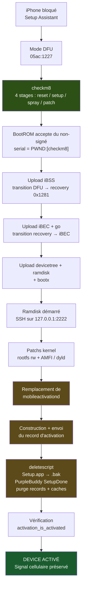
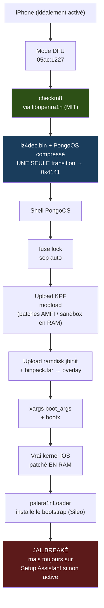
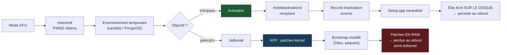
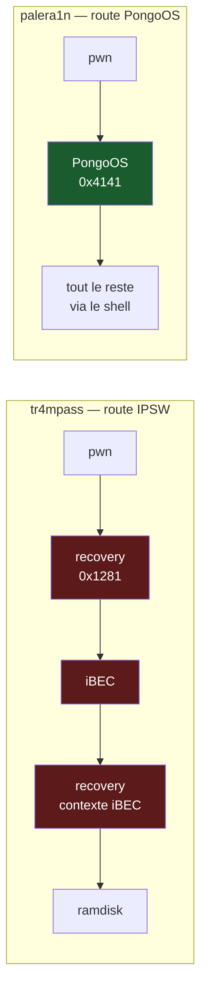

# tr4mpass vs palera1n — deux routes, deux objectifs

> **Note** : ce document compare les **routes techniques** de deux outils qui
> partagent la même porte d'entrée (checkm8) mais poursuivent des objectifs
> différents. Il a été écrit après la validation du stage checkm8 sur Mac Apple
> Silicon en USB-C → Lightning direct (voir
> [`RESEARCH-apple-silicon-usb-c-dfu.md`](RESEARCH-apple-silicon-usb-c-dfu.md),
> expérience E19).

---

## 1. L'objectif, formulé sans ambiguïté

Un iPhone bloqué sur l'**Assistant de configuration** (Setup Assistant) est
inutilisable : pas d'accès à l'écran d'accueil, pas de réseau, pas de SIM
exploitable. Le débloquer suppose **quatre** choses distinctes :

| # | Ce qu'il faut obtenir | Pourquoi c'est nécessaire |
|---|---|---|
| 1 | Le BootROM accepte du code non signé | Sans ça, aucun code tiers ne s'exécute sur le device |
| 2 | Un environnement d'exécution temporaire (ramdisk) | Permet d'écrire sur le système de fichiers |
| 3 | L'activation enregistrée côté `mobileactivationd` | Sinon iOS reste sur l'écran Setup |
| 4 | Setup Assistant neutralisé (`Setup.app` + PurpleBuddy) | Sinon il se relance au boot |

**« Signal préservé »** signifie que l'étape 3 est faite *proprement* : le
baseband reste appairé, l'IMEI/MEID est reconnu, les appels et données
fonctionnent. Une activation bâclée donne un device qui démarre mais reste en
« Recherche… » sans réseau cellulaire.

C'est ce que tr4mpass vise. **palera1n ne vise pas ça** — il vise un
*jailbreak* (exécuter du code non signé en permanence, installer des paquets).
Les deux ont besoin des étapes 1 et 2, puis divergent totalement.

---

## 2. Route tr4mpass — Path A (A5 → A11)

**Transitions USB : 3** (DFU → recovery → iBEC → bootx). Chacune est un
point de fragilité potentiel sur les ports USB-C d'Apple Silicon — c'est
exactement ce que palera1n documente comme problématique en aval du pwn.

**Ce qui produit la persistance** : les fichiers écrits sur le système de
fichiers (`mobileactivationd` remplacé, `Setup.app` renommé, plists). Le
device reste activé après reboot, parce que l'état est **sur le disque**.

---

## 3. Route palera1n (v3.0.0-beta.3)

**Transitions USB : 1** (DFU → PongoOS). C'est son avantage technique réel sur
Apple Silicon : une seule bascule, la même mécanique qui fonctionne déjà.

**Ce qui produit la « persistance »** : deux couches.
- Les patches kernel vivent **en RAM uniquement** → perdus à chaque reboot
  (d'où le caractère *semi-tethered*).
- Le bootstrap (Sileo, tweaks) vit sur un 2ᵉ volume APFS (« fakefs ») ou
  `/var/jb` → persiste.

**Ce qui ne persiste pas** : l'activation. palera1n n'y touche jamais.

---

## 4. Où les deux routes se séparent

Les deux consomment les mêmes étapes 1 et 2. **Tout ce qui suit diverge.**
Un device non activé reste non activé après palera1n, quel que soit son
succès de jailbreak.

---

## 5. Tableau comparatif — ce que l'un fait, ce que l'autre ne fait pas

### 5.1 Capacités

| Capacité | tr4mpass (Path A) | palera1n |
|---|:---:|:---:|
| Exploiter checkm8 (A5 → A11) | ✅ | ✅ |
| Obtenir `PWND:[checkm8]` | ✅ | ✅ |
| Démarrer un environnement non signé | ✅ ramdisk iOS | ✅ PongoOS |
| Patcher le kernel | ✅ (rootfs rw + AMFI/dyld) | ✅ (KPF : AMFI, sandbox) |
| **Soumettre un record d'activation** | ✅ `mobileactivation_activate` | ❌ **jamais** |
| **Remplacer `mobileactivationd`** | ✅ backup + SCP + chmod/chown + vérif | ❌ **jamais** |
| **Neutraliser `Setup.app`** | ✅ renommé en `.bak` (réversible) | ❌ **jamais** |
| **Marquer PurpleBuddy `SetupDone`** | ✅ écriture du plist | ❌ **jamais** |
| **Purger les records d'activation** | ✅ | ❌ **jamais** |
| **Vérifier l'état d'activation final** | ✅ `activation_is_activated` | ❌ **jamais** |
| **Logique « Signal préservé »** | ✅ détection GSM / CDMA / dual | ❌ **jamais** |
| Installer un gestionnaire de paquets | ❌ | ✅ Sileo via bootstrap |
| Installer des tweaks / dylibs | ❌ | ✅ |
| Supporter A12+ (Path B) | ✅ | ❌ (checkm8 s'arrête à A11) |
| Fonctionner sur device **déjà activé** | ✅ | ✅ |
| Fonctionner sur device **non activé** | ✅ (c'est le but) | ⚠️ jailbreak oui, activation non |

### 5.2 Transport et fiabilité (Mac Apple Silicon, USB-C direct)

| Critère | tr4mpass (Path A) | palera1n |
|---|---|---|
| Backend USB promu | IOKit direct (`DeviceRequestTO`) | IOKit (libopenra1n) |
| Backend libusb | ✅ (Linux/Windows) | ✅ (build alternatif) |
| **Transitions USB après le pwn** | **3** | **1** |
| Exposition au bug USB-C M-series | élevée (zone documentée) | faible |
| Redémarrage requis après le pwn | non | non |
| État après reboot | ⚠️ dépend de l'écriture disque | semi-tethered (relancer l'outil) |
| Nécessite un IPSW | ✅ oui (iBSS/iBEC/devicetree/ramdisk) | ❌ non (payloads embarqués) |
| Nécessite des payloads pongoOS | ❌ non | ✅ oui (artefacts CI) |
| Licence | — | MIT (libopenra1n) |

### 5.3 Couches de persistance

| Couche | tr4mpass | palera1n |
|---|---|---|
| Patches kernel | appliqués depuis le ramdisk, **écrits sur disque** | **RAM seulement** |
| `mobileactivationd` | ✅ remplacé sur `/mnt1/usr/libexec/` | — |
| Bootstrap / paquets | — | 2ᵉ volume APFS ou `/var/jb` |
| Apps visibles par l'utilisateur | — | palera1nLoader dans `/Applications` |
| Survit au reboot | ✅ oui (état disque) | ❌ non pour le kernel |

### 5.4 État de validation (honnêteté)

| Élément | tr4mpass | palera1n |
|---|---|---|
| checkm8 sur cette machine | ✅ **prouvé E19** (`PWND:[checkm8]`) | ✅ prouvé E16 |
| Étapes 3 à 8 (activation) | ⚠️ **écrites, jamais exécutées** | — (n'existent pas) |
| Jailbreak complet | — | ✅ outil en production |
| Tests | 62/62 unitaires | — |

> **C'est le point le plus important de ce document.** Le code d'activation de
> tr4mpass (`src/pipeline/`, `src/activation/`, ~2980 lignes) est complet mais
> n'a **jamais tourné sur un device**, parce que checkm8 bloquait tout en amont.
> La validation E19 lève ce blocage pour la première fois. palera1n, à
> l'inverse, est éprouvé — mais ne sait pas activer.

---

## 6. Ce qu'il y a réellement à emprunter à palera1n

Un seul élément, et il n'est pas du code métier :

**Le transport en une seule transition.** L'idée de faire porter le payload du
stage 4 par un environnement complet (PongoOS compressé + `lz4dec.bin`)
plutôt que par un petit shellcode, pour que le device bascule directement en
mode exploitable sans repasser par recovery.

Les trois étapes rouges sont trois occasions de perdre le device sur un port
USB-C d'Apple Silicon. L'étape verte est une seule occasion.

**Mais** : adopter cette route suppose de renoncer au ramdisk iOS extrait d'un
IPSW, donc de trouver un ramdisk alternatif contenant les outils d'activation
(`mobileactivationd`, AFC, SSH…) — c'est un chantier, pas un portage.

**Décision** : à ne faire que si le test de transition iBSS échoue.
Si les 3 transitions passent, la route IPSW (déjà entièrement écrite) reste
la plus courte.

---

## 7. Résumé en une phrase

> **palera1n** déverrouille l'intérieur du système mais laisse la porte
> d'entrée fermée ; **tr4mpass** ouvre la porte d'entrée, et doit encore
> prouver qu'il sait le faire de bout en bout.

---

## Voir aussi

- [`RESEARCH-apple-silicon-usb-c-dfu.md`](RESEARCH-apple-silicon-usb-c-dfu.md) — journal complet E0 → E20bis
- [`README.md`](README.md) — documentation utilisateur de tr4mpass
- [palera1n](https://github.com/palera1n/palera1n) — dépôt upstream (branche `v3.0.0-beta.3` analysée)
