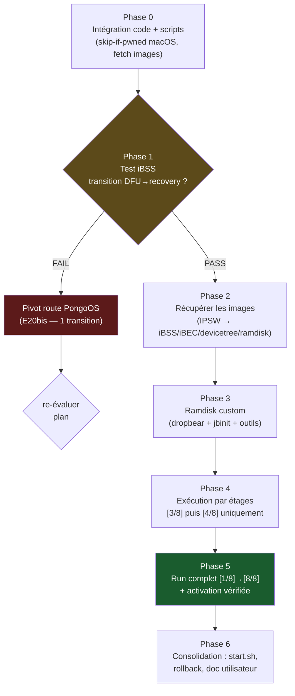

# Plan d'exécution — après checkm8 (Path A)

> **Contexte** : le stage checkm8 est prouvé sur cette machine (E19,
> `PWND:[checkm8]`, câble USB-C direct sans hub). Les étapes [3/8]→[8/8]
> du pipeline (`path_a_ramdisk` → `path_a_deliver` → … → `activation_is_activated`,
> ~2980 lignes) sont écrites mais **n'ont jamais tourné**. Ce plan les fait
> passer de « écrit » à « exécuté », par phases avec portes de décision.
>
> Companion docs :
> [`COMPARISON-palera1n-vs-tr4mpass.md`](COMPARISON-palera1n-vs-tr4mpass.md)
> (routes) · [`RESEARCH-apple-silicon-usb-c-dfu.md`](RESEARCH-apple-silicon-usb-c-dfu.md)
> (journal E0→E20bis).

---

## Vue d'ensemble



**Principe directeur** : chaque phase a une **porte de mesure** — on
n'avance jamais sur une supposition. Le premier échec d'une porte
renvoie à la décision documentée (pivot pongoOS ou débogage ciblé),
pas à une improvisation.

---

## Phase 0 — Intégration code + scripts (pas de device requis)

Objectif : que tout ce qui peut être rendu « sans agent, scriptable »
le soit, et que les re-runs soient sûrs.

| # | Tâche | Fichier | Critère d'acceptation |
|---|---|---|---|
| 0.1 | **Skip-if-pwned sur macOS** : le fast-path `checkm8_verify()==1 → skip` est derrière `#if !defined(__APPLE__)`. Le porter sur Apple (lecture IOKit du serial, sans toucher EP0) pour que `./tr4mpass` soit ré-entrant sans danger. | `src/dfu/checkm8.c` | 2ᵉ run consécutif sur device pwned : log `already processed, skipping`, 0 requête USB écrite. |
| 0.2 | **`scripts/fetch_images.sh`** : orchestre `ipsw_pull.py` pour iBSS/iBEC/devicetree/ramdisk/trustcache depuis l'IPSW de la version détectée ; écrit les chemins dans un fichier d'env prêt à `source`. | `scripts/` (nouveau) | Un `source env` fournit les 4 variables `TR4MPASS_*_PATH` non vides, fichiers non vides. |
| 0.3 | **`scripts/run_path_a.sh`** : assemble l'env (`TR4MPASS_*`) puis lance `./tr4mpass -v` avec `tee` horodaté ; capte le code de sortie ; affiche le serial final. | `scripts/` (nouveau) | Le script refuse de tourner si une `TR4MPASS_*` requise manque (message listant les manquantes). |
| 0.4 | **Exécution par étages** : variable `TR4MPASS_STOP_AFTER=<n>` lue par `path_a_execute` pour s'arrêter après l'étape n (défaut 8). Permet de valider [3/8]+[4/8] sans toucher à `mobileactivationd`. | `src/pipeline/path_a.c` | `STOP_AFTER=4` : les étapes 5-8 ne sont ni loguées ni exécutées ; sortie 0. |
| 0.5 | Vérifier build/tests après chaque changement (`make`, `make test` 62/62). | — | 0 warning, 62/62. |

**Livrable** : tout commité sur `fix/library-usage-audit`, scripts
exécutables, doc d'usage en tête de chaque script.

---

## Phase 1 — Mesure discriminante : test iBSS ⏸ *device requis*

Objectif : trancher la **seule** question technique restante — les
transitions USB post-pwn survivent-elles au câble direct USB-C ?

**Scripts** : déjà écrits (`scripts/ramdisk_test_ibss.sh`,
`scripts/detect_ios.sh`, `scripts/ipsw_pull.py`). Deux passes :

```sh
# Passe 1 — consomme le pwned courant, détecte iOS, tire le iBSS
scripts/ramdisk_test_ibss.sh
# … puis remise en DFU (boutons) + re-pwn :
./tr4mpass -v
# Passe 2 — détection en cache : upload iBSS + surveillance PID 0x1281
scripts/ramdisk_test_ibss.sh
```

| Résultat | Décision |
|---|---|
| `PASS` (PID 0x1281 observé, sans replug) | → **Phase 2** (route IPSW confirmée) |
| `FAIL` (aucune transition en 60 s) | → pivot **route PongoOS** (E20bis) : intégrer `libopenra1n` (MIT) + `yolo_s8000.bin` — 1 transition seule ; re-plan requis avant Phase 2 |

**Preuve à archiver** : log horodaté dans `/tmp/`, entrée E21 dans le
journal de recherche.

---

## Phase 2 — Récupérer les images (⏸ après porte Phase 1 = PASS)

Objectif : assembler, depuis l'IPSW **de la version installée**, tout
ce que `path_a_ramdisk.c` exige.

| Image | Variable d'env | Extraction | Taille attendue |
|---|---|---|---|
| iBSS (`iBSS.n71[~].im4p`) | `TR4MPASS_IBSS_PATH` | Range-request (~200 Ko) | ~200 Ko |
| iBEC (`iBEC.n71[~].im4p`) | `TR4MPASS_IBEC_PATH` | Range-request | ~250 Ko |
| Devicetree (`DeviceTree.n71ap.im4p`) | `TR4MPASS_DEVICETREE_PATH` | Range-request | ~100 Ko |
| Ramdisk | `TR4MPASS_RAMDISK_PATH` | Range-request | ~20-60 Mo |
| Trustcache (iOS 14+ uniquement) | `TR4MPASS_TRUSTCACHE_PATH` | facultatif | — |

```sh
scripts/fetch_images.sh            # → écrit ~/.cache/tr4mpass/images/env.sh
source ~/.cache/tr4mpass/images/env.sh
```

**Notes d'honnêteté** :
- Deux variantes de carte pour l'A9 (n71 TSMC / n71m Samsung) — le
  device choisit via BDID ; `fetch_images.sh` tire les deux.
- Le **ramdisk stock** ne suffit pas pour la Phase 3 (voir ci-dessous) ;
  on le récupère quand même : il sert de base de patching.

**Porte** : `file` non vides + checksums notés dans le journal.

---

## Phase 3 — Ramdisk custom (le plus gros chantier hors code)

> **Principe permanent (directive utilisateur)** : avant d'écrire quoi que
> ce soit, vérifier qu'un outil existant ne fait pas déjà l'étape. Tableau
> de mapping ci-dessous — chaque ligne = un outil existant, pas du code
> nouveau.

Objectif : le ramdisk doit contenir ce que `path_a` suppose présent :
**dropbear sur 2222**, **`/usr/bin/jbinit`** (patcher AMFI appelé par
`path_a_ssh.c`), outils POSIX de base. Le ramdisk IPSW n'a rien de ça.

### 3.0 — Outils existants d'abord (mapping étape → outil)

| Étape du plan | Outil existant | Repo / source | Statut |
|---|---|---|---|
| Télécharger/extraire IPSW | `ipsw` (MIT, Go, brew) | https://github.com/blacktop/ipsw | ✅ vérifié (`download ipsw --device --build`, `extract`, `mount rdisk`) — install: `brew install blacktop/tap/ipsw` |
| Construire SSH ramdisk | ~~`ipsw ssh`~~ | https://blacktop.github.io/ipsw/docs/cli/ipsw/ssh/ssh | ❌ **vérifié : c'est un client SSH**, pas un builder. Sous-commandes = `debugserver`/`shsh` seulement. Un stub caché `idev restore-ramdisk` est `panic("not implemented")` |
| SSH ramdisk préconstruit (option B) | Dora2 | github.com/dora2-iOS | ❌ **compte inactif (0 repos)**, releases 404, `jbinit` 404 — option morte |
| Monter le ramdisk stock (aide au patching) | `ipsw mount rdisk IPSW --ident Erase [--key K \| --lookup]` | https://blacktop.github.io/ipsw/docs/cli/ipsw/mount | ✅ vérifié — monte sur l'hôte (pas d'injection) |
| **`mobileactivationd` patché** | *aucun outil connu* | — | ❌ blocker confirmé (option B morte) |
| **[6/8] record + soumission** | `ideviceactivation activate` (libideviceactivation, LGPL) | https://github.com/libimobiledevice/libideviceactivation | ✅ vérifié README : « Implements complete activation and deactivation process » + CLI. **Décision gate** : tester sur le device ramdisk AVANT notre `path_a_activate` |
| Patcher iBoot/dyld du ramdisk | iBoot64Patcher, img4tool, iExtractor | déjà listés dans README References | ✅ connus — restent requis pour l'option C |
| [7/8] deletescript | *pas d'équivalent connu* | — | ❌ code tr4mpass conserve |

**Conséquence vérifiée (2026-11-01)** : l'option A (`ipsw ssh`) est morte,
l'option B (Dora2) est morte ⇒ **l'option C (pipeline manuel :
`ipsw mount rdisk` → injection dropbear/jbinit → iBoot64Patcher →
img4tool/IMG4 rebuild) est le chemin restant** — c'est plus de travail
que prévu, et le blocker `TR4MPASS_PATCHED_MAD` reste entier.
`scripts/build_ramdisk_ssh.sh` implémente la gate runtime : si un futur
`ipsw ssh ramdisk` apparaît, le script l'utilisera ; sinon il échoue
avec la commande d'upgrade exacte (pas de workaround).

**Impact majeur restant** : `ideviceactivation activate` (vérifié) peut
remplacer notre étape [6/8] C pour le premier run device — notre code
`activation/*.c` (calqué sur ce tool + go-ios, cf. README References)
reste le fallback documenté. Attention licence si link statique
(LGPL2.1 lib / GPL3 CLI — cf. COPYING du repo).

| Option | Méthode | Coût | Risque |
|---|---|---|---|
| ~~A~~ | ~~`ipsw ssh`~~ — vérifié : client SSH, pas un builder | — | ❌ mort (2026-11-01) |
| ~~B~~ | ~~Dora2 préconstruit~~ — vérifié : compte inactif, releases 404 | — | ❌ mort (2026-11-01) |
| **C (seule restante)** | Pipeline manuel : `ipsw mount rdisk` (montage hôte du RestoreRamDisk) → injection dropbear + outils → iBoot64Patcher (iBEC/iBoot) → img4tool (repack IMG4) | élevé | plusieurs outils à chaîner ; WKEY de déchiffrement du ramdisk requise (`ipsw` peut la lookup) |

**Entrée externe** (`TR4MPASS_PATCHED_MAD`) — voir 3.0 : SI un ramdisk
Dora2/hacktivation bundle déjà le binaire patché, on le récupère et
le blocker disparaît. Sinon, décision projet : le construire depuis
les sources libideviceactivation/go-ios citées, ou l'obtenir ailleurs.

**Porte** : le ramdisk custom booté manuellement via
`irecovery -f` + `bootx` expose SSH sur 2222 (testable au `nc`/`ssh`
avant d'intégrer tr4mpass).

---

## Phase 4 — Exécution par étages (⏸ après porte Phase 3)

Objectif : faire tourner les étapes réellement neuves, une par une.

```sh
source ~/.cache/tr4mpass/images/env.sh
export TR4MPASS_PATCHED_MAD=/chemin/vers/mobileactivationd.patched

# Étage A : [1/8]+[2/8] (re-pwn) + [3/8] ramdisk + [4/8] patches — SANS activation
scripts/run_path_a.sh --stop-after 4
```

| Étage | Étapes validées | Porte de succès |
|---|---|---|
| A | pwn + ramdisk + kernel patches | SSH vivant après `bootx` ; logs `amfi-patch` OK |
| B | + [5/8] remplacement `mobileactivationd` | `replace_mad: mobileactivationd replaced and verified` |
| C | + [6/8] record + [7/8] deletescript | `Activation record submitted` ; Setup.app renommé |
| D | + [8/8] vérification | `path_a: === Process successful -- device is activated ===` |

Après chaque étage : noter l'état device (reboot ? signal ? écran ?)
dans le journal. Un échec à l'étage B/C/D laisse le device dans un
état **récupérable** (restauration classique possible à tout moment).

---

## Phase 5 — Run complet

```sh
scripts/run_path_a.sh     # [1/8] → [8/8], une passe, logs horodatés
```

**Critère final** : device booté sous iOS, activé, **signal cellulaire
présent**, et re-entrée sur Setup impossible. Entrée E2x « succès
complet » au journal ; mise à jour README (tableau support).

---

## Phase 6 — Consolidation

- `start.sh` : ajouter la détection « device déjà pwned » (-phase 0.1) et
  proposer « reprendre le pipeline post-pwn » au lieu de re-pwn.
- Rollback documenté (le device peut toujours être restauré via
  Finder/Apple Devices — le noter en tête de README).
- Mise à jour `COMPARISON-*.md` : remplir la colonne « validation ».
- Nettoyage : retirer les flags d'expérimentation devenus inutiles
  (`TR4MPASS_SKIP_CLRSTATUS`, `TR4MPASS_PRE_STATUS`,
  `TR4MPASS_STAGE4_TIMEOUT_MS`) — ou les garder avec mention E19.

---

## Risques et plan B (résumé)

| Risque | Phase | Plan B |
|---|---|---|
| Transition USB-C échoue | 1 | pivot PongoOS (1 transition, E20bis) |
| Ramdisk custom échoue au boot | 3 | option B (préconstruit) puis C (manuel) |
| `mobileactivationd` patché indisponible | 3-4 | blocker identifié — décision projet à prendre |
| `mobileactivation_activate` rejette le record | 5 | déboguer via logs session (drmHandshake) — code déjà instrumenté |
| Device réagit mal aux patches AMFI | 4 | `STOP_AFTER=3` pour isoler, restauration possible |

---

## Ce qui est déjà prêt (inventaire)

| Actif | État |
|---|---|
| checkm8 gaster-exact (E19) | ✅ prouvé device |
| `scripts/ipsw_pull.py` (Range-request) | ✅ testé (4 builds sondés) |
| `scripts/detect_ios.sh` | ✅ prêt |
| `scripts/ramdisk_test_ibss.sh` | ✅ prêt, en attente du run |
| `path_a_ramdisk.c` / `path_a_ssh*.c` / `activation/*` / `deletescript.c` | ✅ écrits, jamais exécutés |
| Tests | ✅ 62/62, 0 warning |
| Journal E0→E20bis | ✅ à jour |

**Première action concrète quand le device est à disposition : Phase 1
(2 minutes), qui décide de tout le reste.**
